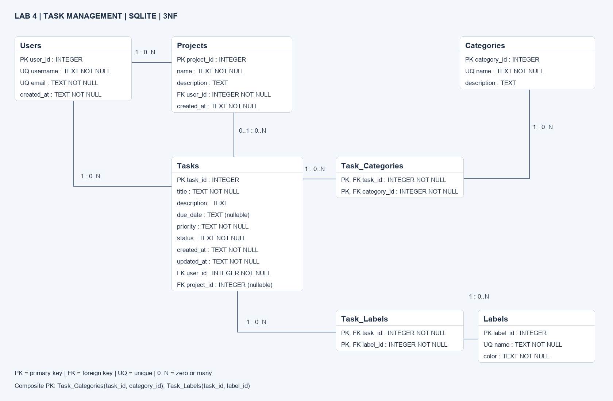

# Лабораторная работа №4 — моделирование данных

Проектирование и нормализация реляционной базы данных приложения управления
задачами. СУБД: SQLite. Итог: семь таблиц в 3NF, ключи, ограничения и индексы.



## Быстрый запуск

Нужен Python 3.9+ со стандартным модулем sqlite3, сторонних зависимостей нет.
Из корня репозитория:

```bash
python3 scripts/create_database.py
python3 -m unittest discover -s tests -v
```

Первая команда создаёт `tasks.db` со схемой и тестовыми данными. Существующий файл
не перезаписывается: для повторного запуска укажите новый путь, например
`python3 scripts/create_database.py example.db`.

Альтернатива через SQLite CLI (новый файл):

```bash
sqlite3 -bail example.db < database/schema.sql
sqlite3 -bail example.db < database/seed_data.sql
sqlite3 -header -column example.db < database/queries.sql
```

**На каждом подключении** к БД включайте `PRAGMA foreign_keys = ON` до начала
транзакции. Начальные значения created_at/updated_at задаются автоматически;
при редактировании приложение должно обновлять updated_at самостоятельно.

## Материалы работы

| Файл | Содержание |
| --- | --- |
| [Анализ предметной области](docs/database/domain-analysis.md) | Требования, сущности, связи, бизнес-правила |
| [Нормализация](database/normalization.md) | Исходная структура, 1NF → 2NF → 3NF, зависимости и обоснование |
| [schema.sql](database/schema.sql) | Создание всех таблиц, PK/FK, CHECK, UNIQUE, индексы |
| [seed_data.sql](database/seed_data.sql) | Вымышленные тестовые данные, включая обе связи M:N |
| [queries.sql](database/queries.sql) | Примеры выборок с JOIN, фильтрацией и агрегацией |
| [SVG](docs/database/er_diagram.svg), [PNG](docs/database/er_diagram.png) | ER-диаграмма с атрибутами и кардинальностями |
| [Draw.io](docs/database/er_diagram.drawio) | Редактируемый исходник для app.diagrams.net |
| [Проверки](tests/test_database.py) | 13 тестов целостности и поведения БД |

## Принятые решения

- У задачи ровно один исполнитель и необязательный проект.
- Владелец проекта может отличаться от исполнителя задачи.
- Категории и метки глобальны; задачи связаны с ними через M:N.
- Удаление проекта сохраняет задачи с project_id = NULL.
- Удаление пользователя удаляет его задачи и проекты; задачи других исполнителей
  сохраняются без удалённого проекта.
- Срок: ISO 8601 YYYY-MM-DD или NULL; календарная проверка находится на стороне приложения.
- Статусы: pending, in progress, completed. Приоритеты: low, medium, high.

В учебном шаблоне зависимость от user_id при простом ключе task_id ошибочно названа
частичной. В отчёте показаны корректные примеры частичных зависимостей для 2NF и
транзитивных для 3NF.

## GitHub и проверка преподавателем

- [Wiki: нормализация](https://github.com/Mizzzord/database-lab-4/wiki/normalization)
- [Задачи проектирования](https://github.com/Mizzzord/database-lab-4/issues?q=is%3Aissue)
- [Pull Request и self-review](https://github.com/Mizzzord/database-lab-4/pulls?q=is%3Apr)
- [Автоматические проверки](https://github.com/Mizzzord/database-lab-4/actions)

Процесс: начальный коммит → отдельная ветка → анализ → диаграмма → SQL →
документация и тесты → PR, связанный с Issues → self-review → merge в main.
Документация хранится и в репозитории, и в Wiki, чтобы её можно было читать офлайн.

Основание работы: предоставленное методическое задание «Лабораторная работа 4.
Моделирование данных: Проектирование и нормализация реляционной базы данных».
Готовое приложение и интерфейс не требуются заданием; реализована и проверена база данных.
