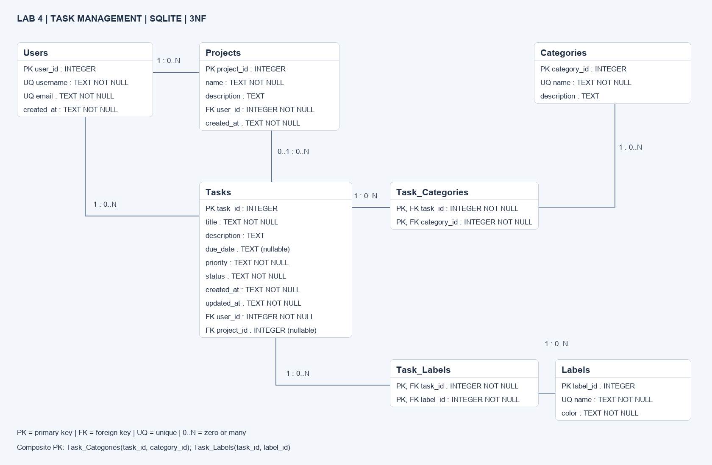

# Процесс проектирования и нормализации базы данных

## 1. Исходная (денормализованная) структура

Приложение управляет задачами, проектами, исполнителями, категориями и метками.
Бизнес-правила подробно приведены в [анализе предметной области](../docs/database/domain-analysis.md).

Исходный вариант:

```text
Tasks_Flat(task_id, title, description, due_date, priority, status,
           created_at, updated_at, user_id, username, email, user_created_at,
           project_id, project_name, project_description, project_user_id,
           project_created_at, categories[], labels[])
```

Например, задача №3 содержит категории `[Важное, Обучение]` и метки
`[Feature, Documentation]`. Массивы в ячейках не соответствуют выбранной
реляционной модели атомарных значений. Данные Марии повторяются в задачах №3, №4, №6.

Аномалии:

- Обновление: email Марии пришлось бы менять в каждой её задаче.
- Вставка: нельзя независимо зарегистрировать пользователя без задачи.
- Удаление: последняя удалённая задача уничтожила бы сведения о её исполнителе.
- Избыточность: описание проекта и цвет метки повторялись бы во множестве строк.

## 2. Первая нормальная форма (1NF)

Каждая ячейка содержит одно значение соответствующего домена; нет повторяющихся групп.
Для демонстрации промежуточной стадии разворачиваем массивы в две таблицы:

```text
TaskCategory_1NF(task_id, category_id, category_name, category_description)
PK = (task_id, category_id)
TaskLabel_1NF(task_id, label_id, label_name, color)
PK = (task_id, label_id)
```

Если у задачи две категории и две метки, это две строки в каждой таблице,
а не четыре строки декартова произведения. В TaskBase_1NF остаётся одна строка
на задачу с атомарными полями задачи, пользователя и проекта.
На этом этапе имена и описания ещё дублируются; 1NF сама по себе этого не запрещает.

## 3. Вторая нормальная форма (2NF)

Выполнена 1NF; каждый неключевой атрибут полностью зависит от каждого кандидатного
ключа, а не от его собственной части.

В TaskCategory_1NF есть частичные зависимости:

```text
category_id → category_name, category_description
(task_id, category_id) → category_name, category_description
```

category_id является частью составного ключа. Аналогично в TaskLabel_1NF:
`label_id → label_name, color`. Выделяем Categories и Labels, а в Task_Categories
и Task_Labels оставляем только составные ключи и внешние ссылки.

TaskBase_1NF с простым ключом task_id уже удовлетворяет 2NF: у одноатрибутного
ключа нет непустой собственной части. Зависимость
`task_id → user_id → username, email` здесь **транзитивная**, не частичная.
Поэтому вынос Users относится к следующему этапу. Это уточняет неточность
пояснения в учебном шаблоне.

## 4. Третья нормальная форма (3NF)

Выполнена 2NF; для каждой нетривиальной функциональной зависимости X → A
детерминант X является суперключом либо A входит в некоторый кандидатный ключ.
В нашей модели устраняем следующие транзитивные зависимости:

```text
task_id → user_id → username, email, user_created_at
task_id → project_id → project_name, project_description,
                        project_user_id, project_created_at
```

Создаём Users и Projects. В Tasks сохраняем только ссылки user_id (исполнитель)
и nullable project_id. Владелец проекта хранится в Projects.user_id.
Свойства категорий и меток уже вынесены на шаге 2NF.

Итоговые зависимости и кандидатные ключи:

| Отношение | Кандидатные ключи | Основная зависимость |
| --- | --- | --- |
| Users | user_id; username; email | каждый ключ → остальные атрибуты |
| Projects | project_id | project_id → name, description, user_id, created_at |
| Tasks | task_id | task_id → title, description, due_date, priority, status, created_at, updated_at, user_id, project_id |
| Categories | category_id; name | каждый ключ → остальные атрибуты |
| Labels | label_id; name | каждый ключ → остальные атрибуты |
| Task_Categories | (task_id, category_id) | нет неключевых атрибутов |
| Task_Labels | (task_id, label_id) | нет неключевых атрибутов |

В рамках принятых бизнес-правил нет иных зависимостей между неключевыми
атрибутами. Все детерминанты нетривиальных зависимостей являются кандидатными
ключами: отношения удовлетворяют 3NF (и BCNF). Повторение FK допустимо и необходимо
для связей; описательные данные при этом не дублируются. Разбиение восстанавливает
данные через JOIN по PK/FK, без потери сведений; отдельные таблицы связей сохраняют
независимые наборы категорий и меток. Для задач без проекта нужен LEFT JOIN.

## 5. Связи M:N, ключи и ограничения

Task_Categories(task_id, category_id) и Task_Labels(task_id, label_id)
реализуют M:N. Составной PK запрещает повторное присвоение одной категории/метки.
Оба столбца явно NOT NULL: это существенно для составных PK в обычных таблицах SQLite.
Внешние ключи запрещают «осиротевшие» ссылки; ON DELETE CASCADE очищает связи.

Все названия обязательны и непусты; username/email уникальны. priority принимает
low/medium/high, status - pending/in progress/completed. Оба поля NOT NULL,
так как CHECK сам по себе не запрещает NULL. Цвет метки - #RRGGBB.
Проект задачи необязателен, исполнитель обязателен.

## 6. Финальная схема и индексы



Доступны также [SVG](../docs/database/er_diagram.svg) и редактируемый
[исходник Draw.io](../docs/database/er_diagram.drawio).
Все столбцы, PK, FK и кардинальности показаны на диаграмме.

[DDL](schema.sql) создаёт семь таблиц и семь явных индексов:
по исполнителю, проекту, сроку, статусу задачи; владельцу проекта; category_id
и label_id таблиц связей. По task_id используются левые префиксы составных PK.
UNIQUE и составные PK создают дополнительные автоматические индексы SQLite.
Индексы ускоряют выборки и поиск дочерних строк, но требуют памяти и замедляют запись;
при реальной нагрузке набор уточняется по EXPLAIN QUERY PLAN.

## 7. Воспроизведение и проверка

```bash
python3 scripts/create_database.py
python3 -m unittest discover -s tests -v
sqlite3 -header -column tasks.db < database/queries.sql
```

Создание БД не перезаписывает существующий файл. SQL-скрипты запускаются один раз
на новой БД, в порядке schema.sql → seed_data.sql. Каждый скрипт транзакционный.
На каждом новом подключении приложение должно выполнить `PRAGMA foreign_keys = ON`
**до** открытия транзакции. Соединение другого процесса не наследует эту настройку.

Тестовые данные: 3 пользователя, 3 проекта, 3 категории, 3 метки, 6 задач,
7 связей с категориями и 6 связей с метками. Есть задача без проекта/срока,
разные статусы/приоритеты, две категории и две метки у одной задачи,
а также исполнитель, отличный от владельца проекта.

13 автоматических тестов проверяют создание БД, данные и JOIN, запрет дубликатов,
NOT NULL/CHECK/FK, значения по умолчанию, индексы, каскады, SET NULL и защиту файла
от перезаписи. PRAGMA integrity_check и foreign_key_check проверяют согласованность.
Проверка 3NF является обоснованием функциональных зависимостей, а не результатом
SQL-теста. Полноценная интеграция с приложением не входит в задание.

## 8. Источники

- [SQLite: внешние ключи и их включение](https://www.sqlite.org/foreignkeys.html).
- [SQLite: CREATE TABLE, ограничения CHECK/NOT NULL/PRIMARY KEY](https://www.sqlite.org/lang_createtable.html).
- Методическое задание «Лабораторная работа 4. Моделирование данных» (предоставленный PDF).
